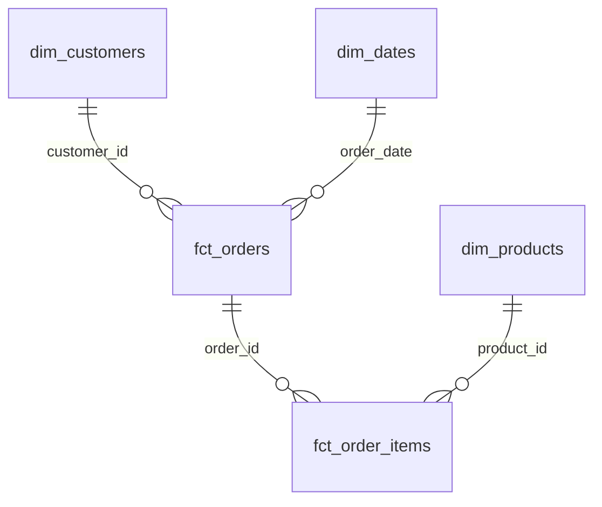
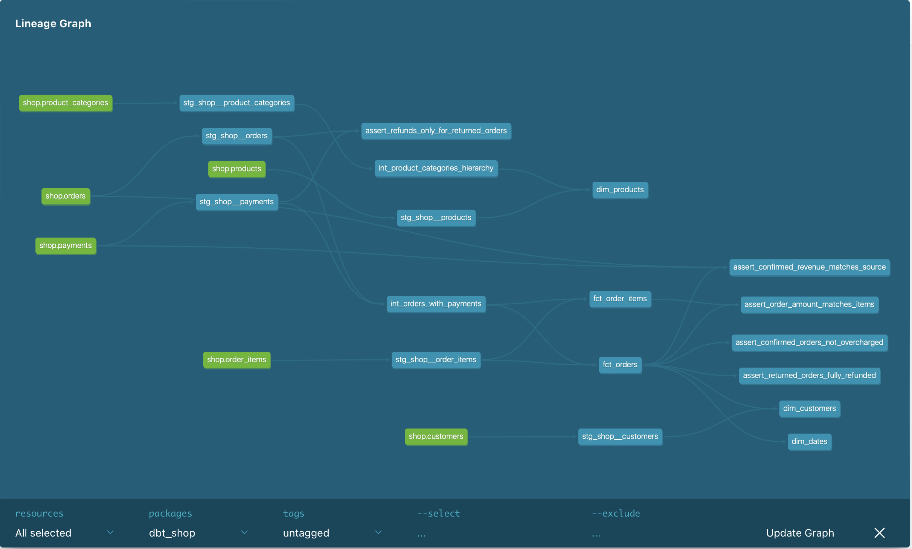

# store_hse

Проект собирает данные интернет-магазина в удобные таблицы для анализа: cначала dbt подготавливает исходные данные, затем объединяет их и строит итоговые витрины.

## Модель данных

- `fct_orders` — один заказ в каждой строке.
- `fct_order_items` — один товар из заказа в каждой строке.
- `dim_customers` — данные о клиентах.
- `dim_products` — данные о товарах и их категориях.
- `dim_dates` — календарные даты.

### Предупреждение: 
у заказа 113 сумма заказа — 200 ₽, но прошло два успешных списания по 200 ₽, поэтому paid_amount равен 400 ₽. Тест assert_confirmed_orders_not_overcharged отмечает эту ситуацию как warn.

## Хранение в Greenplum

| Витрина | Распределение данных | Хранение | Почему выбрано |
|---|---|---|---|
| `fct_orders` | По `order_id` | По столбцам | Заказы удобно соединять и группировать по их номеру. |
| `fct_order_items` | По `order_id` | По столбцам | Позиции заказа проще соединять с соответствующими заказами. |
| `dim_customers` | Копия на каждом сегменте | По столбцам | Таблица небольшая, поэтому её удобно держать рядом с данными заказов. |
| `dim_products` | Копия на каждом сегменте | По столбцам | Небольшой справочник товаров часто нужен при анализе позиций заказов. |
| `dim_dates` | Копия на каждом сегменте | По столбцам | Небольшой календарь удобно соединять с заказами на каждом сегменте. |

Колоночное хранение подходит для аналитики: запросы часто читают отдельные столбцы и считают по ним итоги.

## Граф зависимостей моделей:

