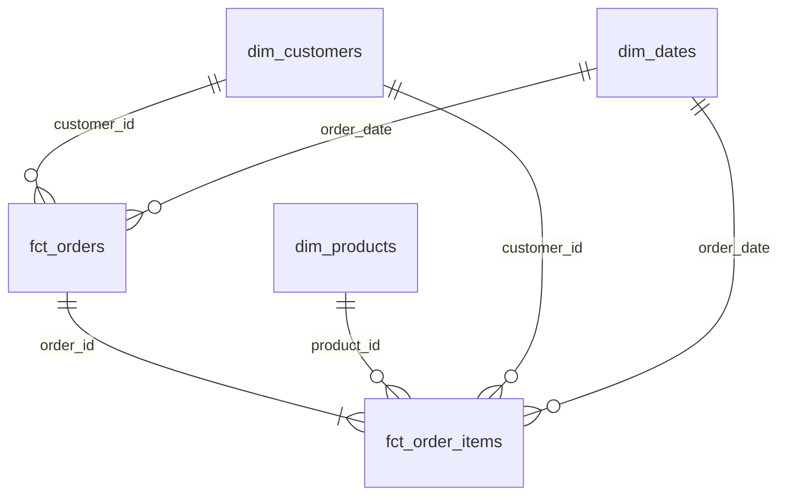


Подтверждённый заказ — заказ со статусом `paid`, по которому была хотя бы одна успешная оплата.



Проект строит витрины интернет-магазина в Greenplum с помощью dbt и помогает анализировать продажи, товары, клиентов и возвраты.

Данные проходят через три слоя:
1. staging - исходные таблицы магазина в удобном для работы виде
2. intermediate - объединение и расчёты, включая дерево категорий
3. marts - факты заказов и измерения клиентов, товаров и дат.

  

## Модель данных

### Витрины

| Витрина | Зернистость | На какой вопрос отвечает |
|---|---|---|
| `fct_orders` | Одна строка — один заказ | Как меняются продажи и средний чек? |
| `fct_order_items` | Одна строка — товар в заказе | Какие товары и категории приносят выручку? |
| `dim_customers` | Одна строка — клиент | Как отличаются покупки клиентов из разных каналов привлечения? |
| `dim_products` | Одна строка — товар | Какие бренды и категории покупают или возвращают чаще? |
| `dim_dates` | Одна строка — календарный день | Как продажи меняются по месяцам, дням недели и сезонам? |

### Хранение в Greenplum

| Витрина | Распределение | Хранение и причина |
|---|---|---|
| `fct_orders` | `order_id` | Таблица по умолчанию; распределение по ключу заказа ускоряет соединение с позициями. |
| `fct_order_items` | `order_id` | Таблица по умолчанию; такой же ключ распределения помогает соединять позиции с заказами. |
| `dim_customers` | Replicated | Маленькая таблица с копией на каждом сегменте, чтоб было удобно соединять с фактами. |
| `dim_products` | Replicated | Маленькая таблица с копией на каждом сегменте, чтоб было удобно соединять с фактами. |
| `dim_dates` | Replicated | Маленькая таблица с копией на каждом сегменте, чтоб было удобно соединять с фактами. |

